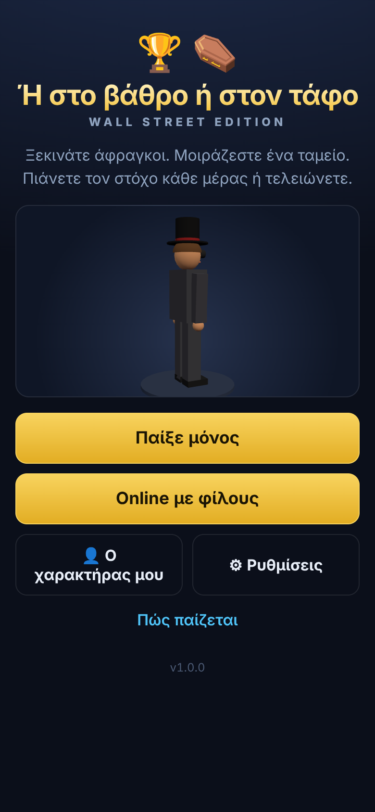
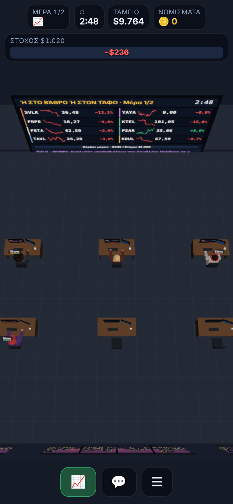
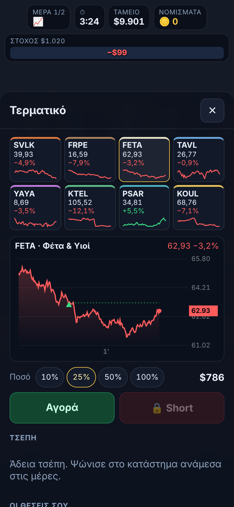
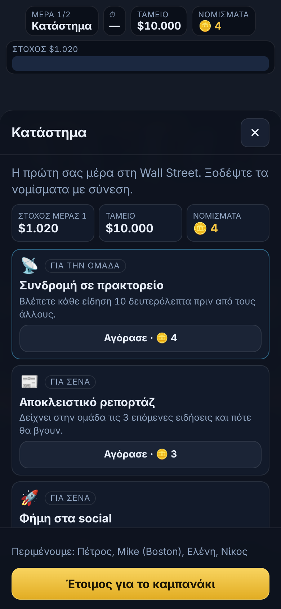
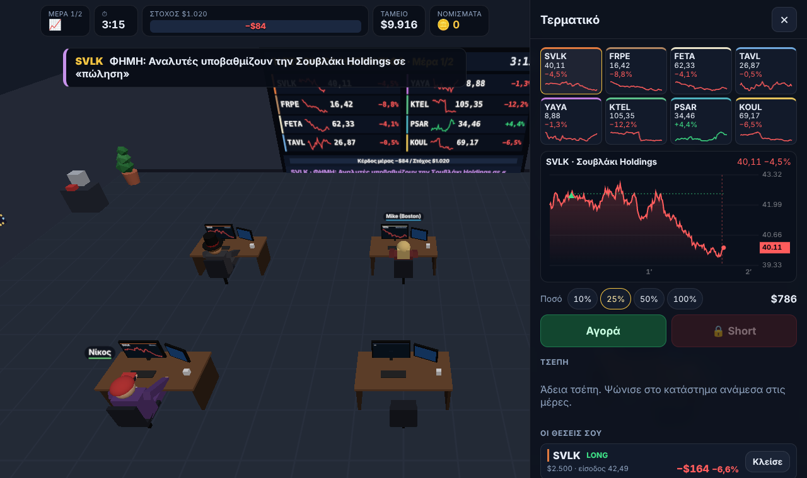
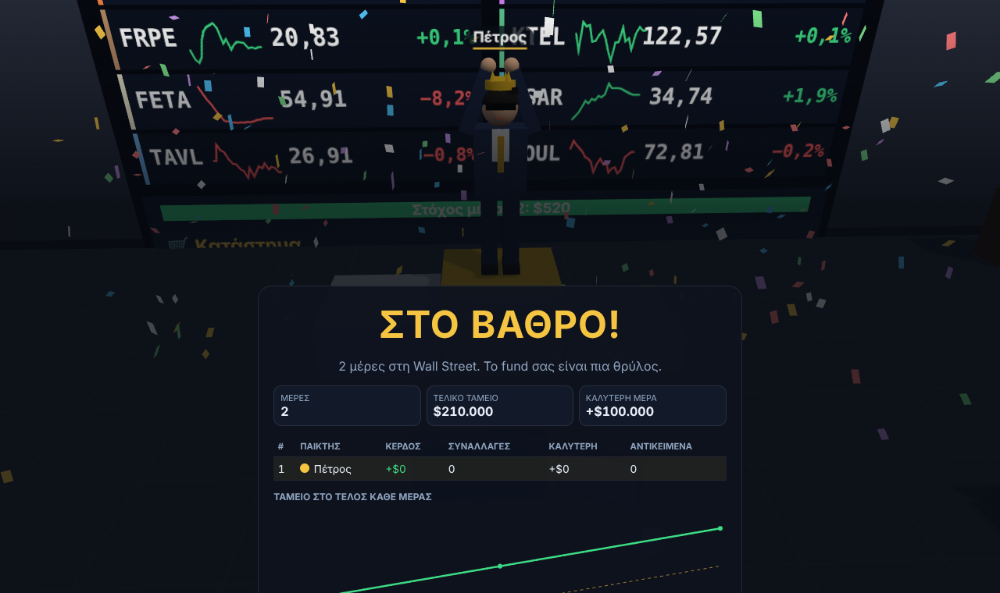
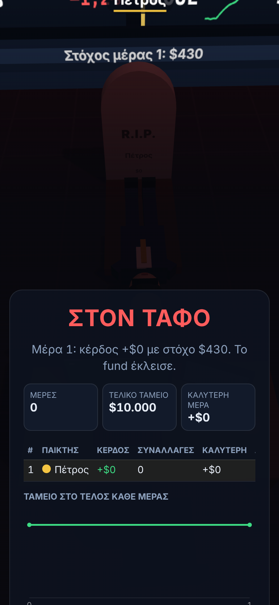

<h1 align="center">Ή στο βάθρο ή στον τάφο · Podium or Grave</h1>

<p align="center">
  <b>Wall Street edition</b><br>
  Co-op παιχνίδι συναλλαγών σε 3D γραφείο · A co-op trading game in a 3D office<br>
  1–10 παίκτες online ή solo · 1–10 players online or solo
</p>

<p align="center">
  <a href="https://petrosfs.github.io/Vathro-i-Tafos-mobile/"><b>▶ Παίξε τώρα · Play now</b></a>
  &nbsp;·&nbsp;
  <a href="#ελληνικά">Ελληνικά</a> · <a href="#english">English</a>
</p>

<p align="center">
  <a href="https://github.com/petrosfs/Vathro-i-Tafos-mobile/actions/workflows/deploy.yml"></a>
</p>

<p align="center">
  
  
  
  
</p>

---

## Ελληνικά

### Τι είναι

Εσύ και έως 9 φίλοι ανοίγετε ένα hedge fund στη Wall Street σχεδόν άφραγκοι. Έχετε **ένα κοινό ταμείο**:
το κέρδος του ενός σώζει την ομάδα, η ζημιά του άλλου τη βουλιάζει. Κάθε μέρα κρατάει λίγα λεπτά και έχει
**στόχο κέρδους** που μεγαλώνει. Αν τον πιάσετε, ψωνίζετε από το κατάστημα αντικείμενα που χειραγωγούν την
αγορά. Αν αποτύχετε, το fund κλείνει: **στον τάφο**. Αν αντέξετε όλες τις μέρες: **στο βάθρο**.

**[▶ Παίξε στο petrosfs.github.io/Vathro-i-Tafos-mobile](https://petrosfs.github.io/Vathro-i-Tafos-mobile/)**,
από κινητό ή υπολογιστή, χωρίς εγκατάσταση και χωρίς λογαριασμό.

### Χαρακτηριστικά

- **3D γραφείο** με γραφεία, οθόνες, μεγάλο πίνακα τιμών και μηχάνημα καταστήματος. Τρεις κάμερες, από τις
  ρυθμίσεις: **πρώτο πρόσωπο**, **τρίτο πρόσωπο** (περπατάς με WASD/ποντίκι ή joystick στο κινητό, E για
  τερματικό, Q για κατάστημα, Esc για μενού) ή **σταθερή από ψηλά**.
- **Χρηματιστήριο που αλλάζει**: ξεκινάτε με 5 φανταστικές μετοχές και φτάνετε ως 12 από έναν κατάλογο 34.
  **Νέες εισαγωγές (IPO)** με hint την προηγούμενη μέρα και πιθανό «πυρετό», **χρεωκοπίες** με ανησυχητικές
  ειδήσεις πριν, μετοχές που ωριμάζουν, τοπικές εταιρείες στην αρχή και διεθνείς από τη Wall Street και πάνω.
  Πολλές ειδήσεις λίγο πριν κινηθεί η τιμή (για εταιρεία, **κλάδο** ή όλη την αγορά), **φήμες** με δηλωμένη
  αξιοπιστία πηγής, **αποτελέσματα** με ώρα γνωστή από το πρωί και πρόβλεψη αναλυτών, τάσεις στο γράφημα,
  **κραχ** και **ράλι**.
- **Ο στόχος είναι πάντα εφικτός**: κάθε μέρα η αγορά δίνει τουλάχιστον μία ευκαιρία αρκετή για 3×/2×/1,5× τον
  στόχο (ανάλογα με τη δυσκολία), άλλοτε με είδηση κι άλλοτε μόνο στο γράφημα.
- **Τέσσερις χώροι**: ξεκινάτε σε **γκαράζ σπιτιού** και μετακομίζετε σε γραφείο πολυκατοικίας, όροφο στη Wall
  Street και ρετιρέ, με νομίσματα ή μετρητά. Αληθινά παράθυρα με θέα: δρόμος με σπίτια, πολυκατοικίες με
  μπαλκόνια, ουρανοξύστες, η πόλη από ψηλά στο ηλιοβασίλεμα.
- **Πορτοφόλι και bonus**: όταν η ομάδα πιάνει τον στόχο, ο καθένας παίρνει ποσοστό από τα κέρδη του. Με αυτό
  στολίζει το γραφείο του, αγοράζει έξτρα οθόνες (ως 6, κάθε μία κι ένα γράφημα ακόμα στο τερματικό) και
  προσλαμβάνει τον «σκλάβο» του.
- **Bots**: συνάδελφοι-bots από το setup, bots για την ομάδα (με νομίσματα) και προσωπικοί «σκλάβοι» (από το
  πορτοφόλι), σε τέσσερα επίπεδα από Ασκούμενο ως Λύκο.
- **Επιτροπή Κεφαλαιαγοράς**: οι υποψίες ανεβαίνουν με τα ύποπτα κόλπα και τα υπερβολικά κέρδη· μια μέρα
  έρχεται έρευνα με απαγορεύσεις και πρόστιμο.
- **Οδηγός πρώτης μέρας** που ο καθένας μπορεί να παραλείψει.
- **Σύλληψη**: αν σας πιάσει η Επιτροπή, έφοδος SWAT (πόρτα, παράθυρα, ελικόπτερο με ντουντούκα) και κελί.
- **Μόστρα**: χρυσό/διαμαντένιο ρολόι και όπλο που πυροβολεί λεφτά.
- **Κλείσιμο της αγοράς** με animation: πάρτι ή καβγάς, ανάλογα με τη μέρα, τον χώρο και τα λεφτά.
- Σύντομα: **παρτίδα με ρόλους** (π.χ. αυτός που βρίσκει funds).
- **18 αντικείμενα**: εσωτερική πληροφορία, φήμη στα social, πανικός στο φόρουμ, αναστολή διαπραγμάτευσης,
  μόχλευση ×3, δάνειο-εξπρές, καφές για παράταση, άδεια για short, stop-loss, χρυσό αλεξίπτωτο κ.ά.
- **Online με φίλους** από οπουδήποτε στον κόσμο, με κωδικό δωματίου ή σύνδεσμο πρόσκλησης. Chat και emotes
  πάνω από τα avatars.
- **Χαρακτήρας** σε στυλ καρτούν (μεγάλο κεφάλι, χοντρά φρύδια, χέρια με δάχτυλα) με κοστούμι, γραβάτα, μαλλιά
  (και αλογοουρά ή καραφλός), μούσι, καπέλο, γυαλιά, μάτια, στόμα και έκφραση.
- **Κουβέντα στο παιχνίδι**: έτοιμες φράσεις που ακούγονται με συνθετική φωνή ή δικό σου κείμενο, σε συννεφάκι πάνω
  από τον χαρακτήρα, χωρίς να κλείσεις το τερματικό. Και **κωλοδάχτυλο** στον συνάδελφο που κοιτάς.
- **Τερματικό σε τρεις στήλες**: γράφημα, αγορά και θέσεις, ειδήσεις, όλα μαζί (στο κινητό με κυλιόμενη μπάρα
  ειδήσεων).
- **Τηλεόραση με δελτίο ειδήσεων** δίπλα στον πίνακα από την πολυκατοικία και πάνω, ασπροπίνακας, διπλώματα,
  πίνακας ανακοινώσεων, ψευδοροφή και ρολόι που δείχνει την ώρα της αγοράς.
- **Κουλοχέρης** στο γραφείο: ο καθένας τζογάρει από το πορτοφόλι του· ό,τι χάνεται μένει στο καζάνι μέχρι
  κάποιος να φέρει 7️⃣7️⃣7️⃣.
- **Γραφείο που το φτιάχνετε εσείς**: διακοσμητικά για το γραφείο του καθενός (λάμπα, κάκτος, κύπελλο, χάλκινος
  ταύρος…) και αναβαθμίσεις για όλη την ομάδα (επαγγελματική καφετιέρα, οθόνες ειδήσεων, καναπές, ενυδρείο…).
  Κάποια ξεκλειδώνουν μόνιμα όταν πετύχετε κάτι.
- **Συνέχεια αργότερα**: η παρτίδα αποθηκεύεται πριν από κάθε μέρα. Από το «Οι παρτίδες μου» τη συνεχίζετε όποτε
  θέλετε, ακόμα και μετά από ενημέρωση του παιχνιδιού.
- **Ρυθμίσεις παρτίδας**: διάρκεια μέρας, δυσκολία, μέρες ως το βάθρο, αρχικό κεφάλαιο, αν το fund κλείνει
  με τον πρώτο χαμένο στόχο ή μόνο με χρεωκοπία (και όριο), ποσοστό bonus, bots.
- **Τελική σκηνή**: βάθρο με τους καλύτερους traders και κομφετί, ή ταφόπλακες. Σύνοψη με διακρίσεις,
  στατιστικά και γράφημα του ταμείου.
- **Ελληνικά και αγγλικά** (αυτόματα από τη γλώσσα της συσκευής), σελίδα κανόνων.

<p align="center"></p>

### Πώς είναι φτιαγμένο

| Κομμάτι | Επιλογή |
| --- | --- |
| Γλώσσα και build | TypeScript + Vite, χωρίς UI framework |
| 3D | Three.js, low-poly μοντέλα από απλά σχήματα, υφές ζωγραφισμένες σε canvas (κανένα αρχείο εικόνας) |
| Αγορά | Ντετερμινιστική προσομοίωση (`src/sim`): όλες οι συσκευές υπολογίζουν τις ίδιες τιμές από το ίδιο seed |
| Online | Ένας παίκτης είναι ο host και τρέχει τη μηχανή· οι κινήσεις και η κατάσταση περνούν από **Firebase Realtime Database** |
| Φιλοξενία | **GitHub Pages**, με αυτόματο test, build και deploy μέσω GitHub Actions· μηδενικό κόστος |

**Δίκαιο για όλους, όπου κι αν είναι.** Οι τιμές δεν ταξιδεύουν στο δίκτυο: κάθε συσκευή τις υπολογίζει μόνη
της. Κάθε κίνηση εκτελείται στην τιμή της στιγμής που πατήθηκε το κουμπί, με ανοχή ως 3 δευτερόλεπτα
καθυστέρησης δικτύου. Έτσι ένας παίκτης από την Αμερική παίζει επί ίσοις όροις.

**Χωρίς server.** Αν φύγει ο host ή «κολλήσει» το ίντερνέτ του για 8 δευτερόλεπτα, αναλαμβάνει αυτόματα ο επόμενος παίκτης και η μέρα συνεχίζει από την
αποθηκευμένη κατάσταση. Όποιος κάνει ανανέωση στη σελίδα, ξαναμπαίνει στο δωμάτιο.

**Ελαφρύ.** Η αρχική φορτώνει χωρίς το Firebase, που κατεβαίνει μόνο όταν πας online. Στα κινητά η
προεπιλογή είναι σταθερή κάμερα και ελαφριά γραφικά.

**Ποιότητα.**
- **67 τεστ** (Vitest), με προσομοιώσεις χιλιάδων τυχαίων κινήσεων που ελέγχουν ότι το ταμείο δεν γίνεται
  ποτέ αρνητικό και ότι δεν χάνεται θέση.
- Κατά την ανάπτυξη, **δοκιμές σε πραγματικό browser** (Playwright) με τοπικό Firebase emulator: παρτίδες
  10 παικτών, αλλαγή host στη μέση της μέρας, επανασύνδεση μετά από ανανέωση, επιστροφή στο δωμάτιο.

### Δομή του κώδικα

```
src/
  sim/      αγορά, ειδήσεις, αντικείμενα, κανόνες (καθαρές συναρτήσεις)
  game/     host, «εικόνα» της παρτίδας στη συσκευή, solo
  net/      Firebase, δωμάτια, συγχρονισμός
  three/    3D γραφείο, avatars, κάμερες, βάθρο και τάφοι
  ui/       τερματικό, κατάστημα, chat, γραφήματα, σύνοψη
  screens/  αρχική, χαρακτήρας, ρυθμίσεις, online, lobby, παρτίδα, κανόνες
  i18n.ts   ελληνικά και αγγλικά
```

### Τοπική εκτέλεση

```bash
npm install
npm run dev     # τοπικός server
npm test        # τεστ
npm run build   # build στον φάκελο dist
```

Για δικό σου online: φτιάξε project στο Firebase με **Anonymous Authentication** και **Realtime Database**,
επικόλλησε τους κανόνες από το `database.rules.json` και βάλε τα στοιχεία της web εφαρμογής στο
`src/net/config.ts`.

<p align="center">
  
  
</p>

---

## English

### What it is

You and up to 9 friends open a Wall Street hedge fund with almost no money. You share **one balance**: one
player's profit saves the team, another's loss sinks it. Each day lasts a few minutes and has a growing
**profit quota**. Hit it and you buy items that manipulate the market. Miss it and the fund closes: **into the
grave**. Survive every day: **onto the podium**.

**[▶ Play at petrosfs.github.io/Vathro-i-Tafos-mobile](https://petrosfs.github.io/Vathro-i-Tafos-mobile/)**, on a
phone or a computer, with no install and no account.

### Features

- **3D office** with desks, monitors, a big price board and a shop machine. Three cameras in settings:
  **first person**, **third person** (walk with WASD/mouse or a joystick on phones, E for the terminal, Q for
  the shop, Esc for the menu) or a **fixed overhead view**.
- **A changing stock exchange**: start with 5 fictional stocks and grow to 12 from a catalogue of 34. **IPOs**
  with a hint the day before and possible “fever”, **bankruptcies** foreshadowed by worrying headlines, stocks
  that mature, local companies early and international ones from Wall Street up. Headlines just before the price
  moves (about a company, a **sector** or the whole market), **rumors** with a stated source reliability,
  **earnings** with a time known from the morning plus analyst forecasts, chart trends, **crashes** and **rallies**.
- **The quota is always reachable**: every day the market offers at least one opportunity worth 3×/2×/1.5× the
  quota (depending on difficulty), sometimes announced by a headline, sometimes only visible on the chart.
- **Four premises**: start in a **home garage** and move to an apartment-block office, a Wall Street floor and a
  penthouse, paying with coins or cash. Real windows with a view: a street with houses, apartment blocks with
  balconies, skyscrapers, the city from above at sunset.
- **Wallet and bonus**: when the team hits the quota, everyone gets a share of their own profit, used to decorate
  their desk, buy extra screens (up to 6, each one more chart in the terminal) and hire their minion.
- **Bots**: bot colleagues from the setup, team bots (paid with coins) and personal minions (paid from the wallet),
  in four levels from Intern to Wolf.
- **Securities Commission**: suspicion rises with shady tricks and outsized profits; one day an investigation
  arrives with bans and a fine.
- **First-day guide** that anyone can skip.
- **Arrest**: if the Commission catches you, a SWAT raid (door, windows, a helicopter with a megaphone) and a cell.
- **Show-off**: gold/diamond watches and a money gun.
- **Closing-bell animation**: a party or a fight, depending on the day, the premises and the money.
- Coming soon: **a game with roles** (e.g. the one who finds funds).
- **18 items**: insider tip, social media hype, forum panic, trading halt, ×3 leverage, express loan, coffee
  for extra time, short-selling licence, stop-loss, golden parachute and more.
- **Online with friends** from anywhere in the world, via a room code or an invite link. Chat and emotes over
  the avatars.
- **Cartoon character** (big head, bold brows, hands with fingers) with suit, tie, hair (including a ponytail or
  shaved bald), facial hair, hat, glasses, eyes, mouth and expression.
- **In-game talk**: ready phrases spoken with a synthetic voice or your own text, in a bubble over your character,
  without closing the terminal. Plus a **middle finger** for the colleague you are looking at.
- **Three-column terminal**: chart, trading and positions, news, all at once (on phones with a scrolling news bar).
- **News TV** next to the board from the apartment office up, a whiteboard, diplomas, a notice board, a drop
  ceiling and a clock showing market time.
- **Slot machine** in the office: everyone gambles from their own wallet; losses stay in the pot until someone
  hits 7️⃣7️⃣7️⃣.
- **An office you build**: decorations for each player's desk (lamp, cactus, trophy, bronze bull…) and upgrades
  for the whole team (pro espresso machine, news screens, sofa, aquarium…). Some unlock permanently as you
  achieve things.
- **Continue later**: the game is saved before every day. Resume it from “My games” whenever you like, even after
  a game update.
- **Game settings**: day length, difficulty, days to the podium, starting capital, whether the fund closes at
  the first missed quota or only on bankruptcy (and the threshold), bonus rate, bots.
- **Final scene**: a podium with the best traders and confetti, or tombstones. Summary with awards, stats and
  a balance chart.
- **Greek and English** (automatic from the device language), rules page.

### How it is built

| Part | Choice |
| --- | --- |
| Language and build | TypeScript + Vite, no UI framework |
| 3D | Three.js, low-poly models from simple shapes, textures painted on canvas (no image files) |
| Market | Deterministic simulation (`src/sim`): every device computes the same prices from the same seed |
| Online | One player is the host and runs the engine; moves and state go through **Firebase Realtime Database** |
| Hosting | **GitHub Pages**, with automatic test, build and deploy via GitHub Actions; zero cost |

**Fair wherever you are.** Prices never travel over the network: each device computes them itself. Every trade
executes at the price of the moment the button was pressed, tolerating up to 3 seconds of network delay, so a
player in the US plays on equal terms.

**No server.** If the host leaves or their connection stalls for 8 seconds, the next player takes over automatically and the day continues from the
saved state. Anyone who refreshes the page rejoins the room.

**Lightweight.** The home screen loads without Firebase, which downloads only when you go online. Phones
default to the fixed camera and light graphics.

**Quality.**
- **67 tests** (Vitest), with simulations of thousands of random moves checking that the balance never goes
  negative and no position is lost.
- During development, **real-browser tests** (Playwright) against a local Firebase emulator: 10-player games, a
  host change mid-day, rejoining after a refresh, returning to the room.

### Running locally

```bash
npm install
npm run dev     # local server
npm test        # tests
npm run build   # build into dist
```

For your own online setup: create a Firebase project with **Anonymous Authentication** and **Realtime
Database**, paste the rules from `database.rules.json`, and put your web app's settings in `src/net/config.ts`.

---

<p align="center"><sub>Όλες οι εταιρείες και οι ειδήσεις του παιχνιδιού είναι φανταστικές · All companies and headlines in the game are fictional.</sub></p>
